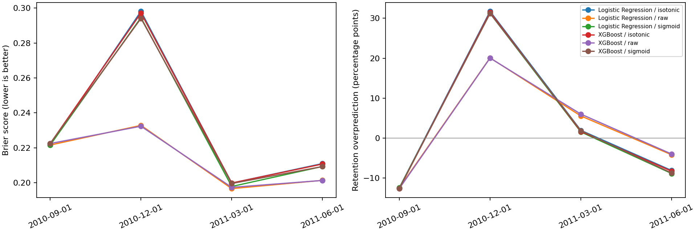
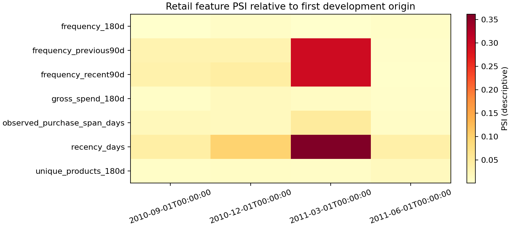

# Weeks 7–8 progress: calibration and retail drift

Completed October 20, 2026. Scope completion, not elapsed-time reporting.

## Completed

- Reviewed README, Weeks 5–6 progress/methodology and actual splitting, preprocessing, tuning and scoring code.
- Preserved five telecom folds per dataset and four retail forward validation origins.
- Compared raw, training-only sigmoid and isotonic probabilities for LR and prespecified fixed XGBoost: 84 outer metric rows.
- Added development-only retail feature PSI, standardized mean shifts, customer overlap, outcome rates and probability-error trajectories.
- Reconciled saved predictions and calibration transformations independently; seven regression tests pass. Final test sets remain reserved.

## Retail findings

Four-origin, equally weighted means for Logistic Regression:

| Method | Brier ↓ | Log loss ↓ | Mean absolute retention error (pp) ↓ |
|---|---:|---:|---:|
| Raw | 0.2131 | 0.6133 | 10.57 |
| Sigmoid | 0.2308 | 0.6543 | 13.53 |
| Isotonic | 0.2326 | 0.6607 | 13.57 |

The first validation origin has no forward calibration history and uses identity fallback. On the three calibratable origins alone, LR Brier is 0.2102 raw, 0.2339 sigmoid and 0.2363 isotonic. Fixed XGBoost shows the same deterioration (four-origin Brier 0.2133 → 0.2313 / 0.2325). Calibration does not deliver an overall improvement under this protocol.

Development retention rates change from 49.9% (June 2010) to 61.9% (September), 37.9% (December), 42.3% (March 2011) and 50.1% (June). December LR raw retention overprediction is 20.08 pp, increasing to 31.22 pp with sigmoid and 31.75 pp with isotonic. March sigmoid reduces signed error from +5.53 to +1.53 pp, but Brier still increases slightly; a better cohort mean does not guarantee better individual probabilities.

March 2011 has the largest feature changes relative to June 2010: recency PSI 0.362, previous-90-day frequency 0.296 and recent-90-day frequency 0.295. Mean recency rises from 59.6 to 81.6 days. These are descriptive distribution shifts, not evidence of a specific causal mechanism or an independently established concept-drift process.

## Telecom context and decision

IBM fixed XGBoost sigmoid Brier changes only slightly (0.13504 → 0.13496); LR is effectively unchanged. Iranian fixed XGBoost sigmoid improves Brier (0.06324 → 0.06125) and log loss (0.20928 → 0.19813). These fixed-model calibration results do not calibrate or supersede the Weeks 5–6 nested-selected Iranian model, whose tuning must be nested again inside any future calibration-score generation.

Retain uncalibrated LR as the retail reference for now. Historical calibration is not supported as a default correction by these four windows. Do not choose a method separately after inspecting each outer window. No final model protocol or final-test claims are declared here. Directional/subgroup explanation stability remains separate unfinished scope.

## Evidence and reproduction

Run `python run_weeks7_8.py` and `python -m unittest discover -s tests`. See [methodology](weeks7_8_methodology.md), [all-fold summary](../outputs/weeks7_8/summary.csv), [calibratable-origin summary](../outputs/weeks7_8/summary_calibratable_origins.csv), [validation checks](../outputs/weeks7_8/validation_checks.json) and [execution metadata](../outputs/weeks7_8/run_metadata.json). The environment's actual package versions are recorded; pandas/scikit-learn differ from the pinned requirements, while original LR validation predictions reproduce within tolerance.
